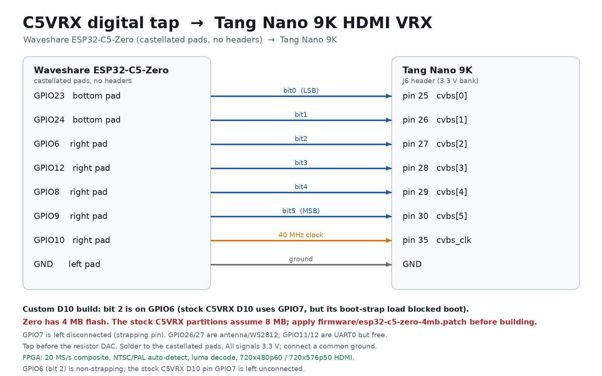

# HDMI analog FPV VRX — Tang Nano 9K + C5VRX

This folder implements the HDMI side of the project described in
[`SPEC.md`](SPEC.md): a C5VRX receiver feeds its digital composite-video tap
to a Tang Nano 9K, and the FPGA turns it into a standard HDMI picture.

**Status:** RTL complete; NTSC and PAL paths verified in simulation; the
FPGA bitstream builds and places/routes cleanly. The HDMI test pattern and
the C5VRX menu raster (through the D10 tap) have both been observed on
hardware via a USB HDMI capture card (OBS). The C5VRX 4 MB D10 build is
flashed and boots, and the final FPGA bitstream is written to the Tang Nano
internal (embedded) flash, so it survives power cycles. No FPV camera/VTX was
connected, so the live camera luma is still to be tested. Colour decoding and
audio are not implemented yet.

## What it does

- Captures the C5VRX-5 **Clock Pin D10** tap: six composite-video bits plus
  a 40 MHz sample clock, 20 MS/s unique codes.
- Recovers horizontal and vertical sync from the composite levels.
- Tracks the sync tip and back-porch level, so the receiver's AFC-dependent
  output level does not need a fixed threshold.
- Low-passes the composite to remove the colour subcarrier and outputs luma.
- Auto-detects NTSC (525/60) and PAL (625/50).
- Line-doubles the captured field into a genlocked CEA-861 HDMI frame:
  **720x480p60** for NTSC or **720x576p50** for PAL, at exactly 27 MHz.
- Shows 75 % colour bars when no receiver is connected or sync is lost.

The tap choice is deliberate. C5VRX has two "FPGA" routes:

| Route | What the FPGA receives | Used here |
| --- | --- | --- |
| **Clock Pin D10** (normal firmware, EXPERIMENTAL menu) | 6-bit composite video + 40 MHz clock | **Yes** |
| `FPGA_IQ` hardware experiment (custom firmware build) | raw Q4/I4 bits, no clock | No — would require a full WBFM demodulator in the FPGA |

The D10 route is the one documented for external capture, preserves the
colour burst, and matches the bench work in C5VRX issue #256. See
[`docs/C5VRX-FIRMWARE.md`](docs/C5VRX-FIRMWARE.md) and
[`docs/VERIFICATION.md`](docs/VERIFICATION.md).

## Wiring



The FPGA side is fixed:

| Tang Nano 9K pin | Header | Signal | Direction |
| --- | --- | --- | --- |
| 25 | J6 | `cvbs[0]` — DAC bit 0 (LSB) | input |
| 26 | J6 | `cvbs[1]` — DAC bit 1 | input |
| 27 | J6 | `cvbs[2]` — DAC bit 2 | input |
| 28 | J6 | `cvbs[3]` — DAC bit 3 | input |
| 29 | J6 | `cvbs[4]` — DAC bit 4 | input |
| 30 | J6 | `cvbs[5]` — DAC bit 5 (MSB) | input |
| 35 | J6 | `cvbs_clk` — 40 MHz sample clock | input |
| GND | J6 | ground | — |

Notes:

- **Tap before the resistor DAC.** The FPGA reads the ESP32 GPIO levels
  directly; it does not need the analog summing node or the 200 Ω load.
- All signals are 3.3 V. Do not feed the analog CVBS node into the FPGA.
- Connect a common ground between the receiver and the Tang Nano.
- Pin 35 is also the LCD clock on the 40-pin FPC connector. Leave that
  connector unconnected when using this design.
- The inputs have weak pull-downs, so a powered-off receiver leaves the
  capture side quiet instead of floating.

**USB and power:** the Zero is powered/flashed over its USB-C port, which is
the ESP32-C5 native USB on GPIO13/14; none of the tap signals use those pins,
so the console and flasher stay available. Power the Tang Nano from its own
USB-C, do not bridge 5 V or 3.3 V between the boards, and run a dedicated
ground wire in the signal bundle. Power the Tang Nano before the Zero drives
the bus (or hold the Zero in reset) so an unpowered FPGA is not back-powered
through its input protection.

**Zero USB console:** the native USB-Serial/JTAG CDC needs **DTR asserted**.
C5VRX's `tools/flash.py` opens with DTR/RTS low (XIAO convention) and makes
the Zero look silent. Use a normal terminal at 115200 with DTR high, or a
script with `DTR=True, RTS=False`. To flash, enter ROM with BOOT/RESET and
use `esptool --before no-reset --after watchdog-reset`; avoid the RTS hard
reset.

Receiver pin map and the Zero flash caveat are in
[`docs/PINMAP.md`](docs/PINMAP.md). The short version:

- **Waveshare ESP32-C5-Zero (no headers):** the stock C5VRX DAC pins are
  all exposed. The **D10-forced build** uses bit 2 on **GPIO6**; the stock
  C5VRX D10 pin GPIO7 is a boot strapping pin and its tap load blocked boot
  on the Zero. Wire bit 2 to GPIO6 and leave GPIO7 disconnected. Solder to
  the castellated pads.
- **4 MB flash:** the Zero has 4 MB, while the stock C5VRX partition table
  assumes 8 MB. Apply
  [`firmware/esp32-c5-zero-4mb.patch`](firmware/esp32-c5-zero-4mb.patch)
  before building; details in
  [`docs/C5VRX-FIRMWARE.md`](docs/C5VRX-FIRMWARE.md). A locally built 4 MB
  test image is in
  [`firmware/build-zero-4mb/`](firmware/build-zero-4mb/). For the FPGA tap,
  a **D10-forced build** is in
  [`firmware/build-zero-4mb-d10/`](firmware/build-zero-4mb-d10/); it needs
  no receiver-menu access and outputs the 40 MHz clock on GPIO10 with bit 2
  on GPIO6 (GPIO7 is a boot strapping pin; leave it disconnected).
- **Already occupied on the Zero:** GPIO26 (antenna switch) and GPIO27
  (WS2812). The tap does not use them. GPIO11/12 are UART0 but free because
  the USB port is the native USB on GPIO13/14.

## Build

### Lushay Code

Open the folder, select `fpga_esp_rx.lushay.json`, and use **Build and
Program**. The project includes only the files in `rtl/`.

### Command line

```sh
./tools/build.sh
```

The script uses the OSS-CAD-Suite path in `OSS_CAD_SUITE` (default:
`/home/aukusti/oss-cad-suite-linux-x64-20261018/oss-cad-suite`) and runs
Yosys, nextpnr-himbaechel and `gowin_pack`. The result is
`fpga_esp_rx.fs`.

Program over USB:

```sh
openFPGALoader -b tangnano9k fpga_esp_rx.fs
# or, to keep it across power cycles (internal/embedded boot flash):
openFPGALoader -b tangnano9k -f fpga_esp_rx.fs
```

The Tang Nano 9K's LittleBee GW1NR-9C boots from its **internal embedded
flash**. The 32 Mbit PUYA chip is an external peripheral flash; writing to it
with `--external-flash` does **not** change the power-on image. Use `-f`
(no `--external-flash`) for a persistent bitstream. The open-source flow may
print `CRC check : FAIL` after an internal-flash write because the UserCode
register reads 0; the write itself can still be valid. Check the design after
a power cycle.

### Simulation

```sh
cd sim
./run.sh ntsc        # ~30 s
./run.sh pal         # a few minutes: waits for PAL auto-detect
```

`run.sh` generates a synthetic 20 MS/s CVBS field, runs the core in Icarus
Verilog, and writes `frame_ntsc.png` or `frame_pal.png`. The checked-in
images were produced by this flow:


## LEDs

| LED | Pin | Meaning |
| --- | --- | --- |
| LED1 | 10 | on when line lock is established |
| LED2 | 11 | on when PAL is detected (off = NTSC) |
| LED3 | 13 | blinks when the 40 MHz D10 capture clock is present |
| LED4 | 14 | blinks when captured lines are advancing |

The LEDs are active low, as on the board.

## Known limitations

- **Luma only.** The composite signal contains colour burst, and the capture
  path preserves it, but this design only filters and displays luma. Adding
  a subcarrier PLL and I/Q demodulator is the next major piece.
- **Line doubling, no frame buffer.** Each captured line is shown twice;
  vertical detail is halved and the last few lines can be cropped because
  the input field and output frame periods differ slightly. A few output
  lines can be black at a field boundary.
- **No audio.** C5VRX does not carry audio on this tap.
- **Partial hardware validation.** The FPGA HDMI test pattern and the
  C5VRX menu raster via the D10 tap are confirmed through a USB capture
  card; the ESP boots the 4 MB D10 firmware. A live FPV camera/VTX picture
  is still to be tested.
- **Not flight-qualified.** C5VRX itself warns that it is experimental. This
  HDMI converter makes no additional safety claim.

## Repository layout

| Path | Contents |
| --- | --- |
| `rtl/top.v` | Tang Nano top: PLL, reset, HDMI output |
| `rtl/cvbs_capture.v` | Capture, sync slicer, luma filter, line writes |
| `rtl/line_buffer.v` | Dual-clock 2x1024x8 ping-pong buffer |
| `rtl/video_out.v` | 480p/576p timing, genlock, resampling, test pattern |
| `rtl/svo_tmds.v` | TMDS encoder (SVO, Clifford Wolf, ISC licence) |
| `rtl/gowin_rpll.v` | 27 MHz → 135 MHz Gowin rPLL wrapper |
| `sim/` | Synthetic CVBS generator and core testbench |
| `firmware/` | 4 MB flash patches and D10-forced test image for the ESP32-C5-Zero |
| `docs/` | Wiring, design, firmware and verification notes |
| `examples/counter/` | Original LED counter demo, kept for reference |

## Credits

C5VRX is by **Twotoz** and the C5VRX contributors:
<https://github.com/Twotoz/C5VRX>. The firmware patches under `firmware/`
are derived from C5VRX and remain under GPL-3.0-only. See
[`CREDITS.md`](CREDITS.md) for full attribution and upstream links.

## Sources

- C5VRX project and D10 tap documentation:
  <https://github.com/Twotoz/C5VRX>
- C5VRX bench measurements of the 40 MHz / 20 MS/s bus, issue #256:
  <https://github.com/Twotoz/C5VRX/issues/256>
- C5VRX research ledger (D10 and FPGA_IQ entries):
  <https://github.com/Twotoz/C5VRX/blob/main/docs/RESEARCH_LEDGER.md>
- Waveshare ESP32-C5-Zero:
  <https://docs.waveshare.com/ESP32-C5-Zero> ·
  <https://docs.waveshare.com/ESP32-C5-Zero/FAQ> ·
  <https://github.com/waveshareteam/ESP32-C5-Zero>
- Tang Nano 9K pin data:
  <https://github.com/litex-hub/litex-boards/blob/master/litex_boards/platforms/sipeed_tang_nano_9k.py>
