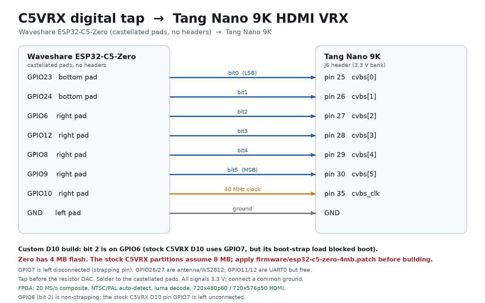

# Pin map

The image is generated by [`../tools/make_pinmap.py`](../tools/make_pinmap.py).

## FPGA side (fixed)

| Tang Nano 9K pin | Header position | Port | Notes |
| --- | --- | --- | --- |
| 25 | J6 | `cvbs[0]` | DAC bit 0 (LSB) |
| 26 | J6 | `cvbs[1]` | DAC bit 1 |
| 27 | J6 | `cvbs[2]` | DAC bit 2 |
| 28 | J6 | `cvbs[3]` | DAC bit 3 |
| 29 | J6 | `cvbs[4]` | DAC bit 4 |
| 30 | J6 | `cvbs[5]` | DAC bit 5 (MSB) |
| 35 | J6 | `cvbs_clk` | 40 MHz PARLIO sample clock |
| GND | J6 | ground | common ground |

- All six data pins and the clock are in bank 2, `LVCMOS33`, with weak
  pull-downs.
- Pin 35 is the RGB-LCD clock pin on the 40-pin FPC connector in Sipeed's
  pinout. It is reused as an input here; do not connect the LCD module at
  the same time.
- The 40 MHz input is buffered by a `BUFG` primitive. The open-source
  placer does not automatically promote this package pin to a global clock,
  and without the buffer the reset/address paths showed a small hold
  violation.

## Receiver side: Waveshare ESP32-C5-Zero

The Zero has **4 MB flash**, **no PSRAM**, native USB on GPIO13/14, and
castellated pads instead of headers. The official pinout groups the pads as:

- left: 5V, GND, 3V3, GPIO0–GPIO5
- right: GPIO11, GPIO12, GPIO13, GPIO14, GPIO10, GPIO9, GPIO8, GPIO7, GPIO6
- bottom: GPIO23, GPIO24, GPIO25, GPIO28

Occupied on the board: **GPIO26** (antenna switch) and **GPIO27** (WS2812
RGB LED). None of the FPGA tap signals use them.

### D10 build map: bit 2 on GPIO6

The stock C5VRX DAC pins are all exposed. This project's forced-D10 build
moves bit 2 to **GPIO6**, not the stock D10 pin GPIO7: GPIO7 is a boot
strapping pin, and with the FPGA tap connected its load prevented the Zero
from booting. GPIO7 is left disconnected.

| DAC bit | C5VRX name | Zero GPIO | Zero pad side | Tang Nano pin |
| --- | --- | ---: | --- | --- |
| bit 0 (LSB) | D4 | 23 | bottom | 25 |
| bit 1 | D5 | 24 | bottom | 26 |
| bit 2 | D3 (custom D10) | 6 | right | 27 |
| bit 3 | D7 | 12 | right | 28 |
| bit 4 | D8 | 8 | right | 29 |
| bit 5 (MSB) | D9 | 9 | right | 30 |
| clock | D10 | 10 | right | 35 |
| ground | — | GND | left | GND |

- GPIO11/12 are UART0 TX/RX, but they are not connected to a USB-UART
  bridge on the Zero; the USB port is the ESP32-C5 native USB on GPIO13/14.
  They are therefore free for the DAC tap. Do not connect a serial adapter
  to GPIO12 while bit 3 is in use.
- GPIO2 is exposed on the Zero but is used internally by C5VRX for its IQ
  loopback; leave it unconnected.
- **GPIO7 is left disconnected.** Stock C5VRX D10 uses it for bit 2, but on
  the Zero with the FPGA tap, its boot-strap load blocked the app from
  booting (confirmed on hardware). The forced build uses GPIO6, which is
  non-strapping and not in C5VRX's IQ pin set.
- GPIO23/24 are on the bottom edge, so the wire bundle leaves the board on
  two sides.
- The "without headers" version has no 2.54 mm pins. Solder to the
  castellated half-holes; do not rely on pressure contacts for the 40 MHz
  clock.
- **4 MB flash:** apply
  [`../firmware/esp32-c5-zero-4mb.patch`](../firmware/esp32-c5-zero-4mb.patch)
  before building C5VRX. The stock partition table assumes 8 MB.
  Details: [`C5VRX-FIRMWARE.md`](C5VRX-FIRMWARE.md).

### Why not the `FPGA_IQ` experiment?

C5VRX also has a `hardware_experiments/fpga_iq` build that sends raw
MODEM_DIAG Q4/I4 bits to an FPGA with **no clock output**. The external
device then owns WBFM demodulation, sync recovery and colour decoding. That
is a much larger FPGA project and the experiment has no board or FPGA check
in the C5VRX repository. This design uses the documented six-bit composite
tap instead.

## Cable notes

- Keep the seven signal wires short (the bench report used ~10 cm leads).
- Data changes on the falling edge of the 40 MHz clock; the FPGA samples on
  the rising edge. At 40 MHz (25 ns period) there is ample margin at these
  lengths, but verify with a scope if the wires are long.
- The receiver can stop its clock during halted restarts and menu/startup
  transitions. The FPGA re-acquires sync automatically and shows colour bars
  while unlocked.

## USB, power and ground

- The Zero is powered and flashed over its USB-C port. That USB is the
  ESP32-C5 native USB on GPIO13/14; none of the FPGA tap signals use those
  pins, so the console and flasher stay available while the tap is wired.
- Power the Tang Nano 9K from its own USB-C port. Do not connect the Zero's
  5 V or 3.3 V to the Tang Nano.
- Run a dedicated ground wire in the signal bundle even when both boards are
  USB-connected. USB grounds are usually common through the host, but the
  wire keeps the 40 MHz return path short and defined. It is mandatory when
  the two boards are powered from separate supplies.
- Power the Tang Nano before the Zero drives the bus, or keep the Zero in
  reset while the FPGA is off. Driving 3.3 V into an unpowered FPGA can
  back-power it through its input protection.
- Both boards are 3.3 V logic; no level shifters are needed.
